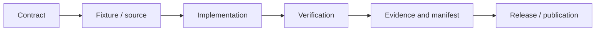

# T02: Benchmark constitution, schemas and provenance

## Overview

Define versioned task, output, score, run and release contracts with content addressing and compatibility rules.

## Why this track exists

This track is a separately testable capability in the PelicanBench programme. It must remain usable for the V1 MVP while preserving a path to calibrated and hardened research infrastructure.

## MoSCoW requirements

### Must

- Define versioned inputs, outputs and acceptance evidence.
- Preserve rights, security, provenance and sealed-set boundaries.
- Include deterministic fixtures or an explicit externally blocked state.
- Link implementation evidence, tests and GitHub phase issues.

### Should

- Expose an implementation-independent interface.
- Quantify uncertainty, failure modes and comparability impact.
- Integrate with the shared ontology, manifest and registry contracts.

### Could

- Add experimental Rust, Mojo, WASM, OpenEnv or live-provider backends.
- Support public visualisation and scholarly outputs.

### Won't in V1

- Claim maturity without independent validation.
- Redistribute rights-restricted historical material.
- Allow agents to autonomously alter normative scoring from sealed results.

## Acceptance criteria

- P0 documents contracts, options, recommendation, decision and risks.
- P1 produces an executable or inspectable vertical slice.
- P2 demonstrates validation, adversarial or reproducibility evidence.
- P3 meets stable-release security, performance, migration and operational gates.

## Architecture

## Dependencies

Shared schema and provenance contracts in T02; governance and workflow in T00; release/drift policy in T20.

## Out of scope

Unreviewed production claims, hidden paid execution and silent changes to public benchmark meaning.

## Serde applicability audit — 18 November 2026

`pelican-core` currently exposes native benchmark structures without a Serde dependency; `pelican-svg` depends on the core. Existing schemas, SVG, provenance and benchmark evaluation do not imply a need for a new Rust serialization framework. **No Serde adoption at present.** Serde cannot replace SVG encoding, human-judged evaluation, statistical scoring or provenance verification.

- [ ] At a real Rust benchmark-runner/API input/output boundary, first pin an independently consumed, versioned DTO and check if the existing representation is sufficient.
- [ ] If a concrete Rust consumer requires JSON, compare Serde-derived DTOs behind a separate optional adapter with the current format and avoid adding Serde to the minimal scoring core.
- [ ] Validate malformed/oversize inputs, schema versions, exact IDs and content hashes, SVG/source lineage and scorer claims with independent corpus tests. A JSON round trip is not an assessment of drawing or scientific scoring quality.
- [ ] Record a no-go without creating a new dependency if no consumer exists; no evidence or prior track completion changes from this note.
